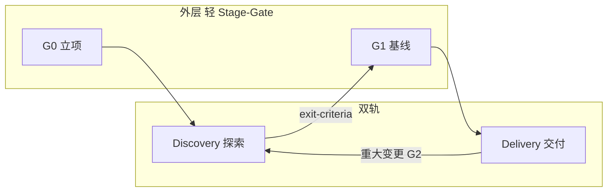

# Tenet

[](LICENSE)
[](tenet/process/OVERVIEW.md)

**Tenet** is an open **meta-layer** for C++ teams: **team rules + AI guidance** — not a clone-and-run scaffold with a fixed folder layout.

You and your AI decide architecture in conversation, then materialize CMake and modules **in your repo**. Tenet defines **when to explore, when to commit files, and what AI must not assume**.

| | |
|---|---|
| **Authority** | [`tenet/AGENTS.md`](tenet/AGENTS.md) (root [`AGENTS.md`](AGENTS.md) routes AI here only) |
| **Start reading** | [`tenet/process/OVERVIEW.md`](tenet/process/OVERVIEW.md) |
| **License** | [MIT](LICENSE) — use, modify, and redistribute with copyright notice |

**中文详细说明见下文**（含零基础入门、嵌入业务仓、与 Cursor 配合）。

---

## 目录

- [Tenet 是什么](#tenet-是什么)
- [适合谁](#适合谁)
- [Tenet 不是什么](#tenet-不是什么)
- [开始之前](#开始之前)
- [快速开始（三选一）](#快速开始三选一)
- [小白第一次跟 Tenet 做项目](#小白第一次跟-tenet-做项目)
- [在自己的 C++ 仓库里安装 Tenet](#在自己的-c-仓库里安装-tenet)
- [和 Cursor / 其他 AI 工具一起用](#和-cursor--其他-ai-工具一起用)
- [流程一览](#流程一览)
- [文档地图](#文档地图)
- [仓库结构](#仓库结构)
- [常见问题](#常见问题)
- [贡献](#贡献)
- [许可证](#许可证)

---

## Tenet 是什么

Tenet 是一套 **开源的流程与 AI 协作规矩**，面向 **C++ 团队**（习惯上参照 20+ 人协作方式，小团队也可裁剪使用）。

可以把它想成 **教练 + 裁判手册**：

- **你的项目** = 场上怎么踢（目录、模块、构建方式）——由 **你 + AI 在对话里定下来**，并写进 **你仓库里的 ADR / 基线文档**。
- **Tenet** = 什么时候必须先想清楚、什么时候才允许大批量写工程文件、AI 在 Discovery 阶段 **不能** 擅自搭「正式架子」。

Tenet **不带** 默认的三层目录、monorepo 成品或必选 CI 模板；它规定的是 **协作与落盘边界**，不是替你选好架构。

---

## 适合谁

| 你可能是… | Tenet 能帮你… |
|-----------|----------------|
| **编程新手**，主要靠 AI 写 C++ | 按 G0 → Discovery → G1 的顺序走，减少「一上来就生成一整棵错误工程树」 |
| **小团队 / 个人项目** | 用轻量 Stage-Gate + 双轨，把探索和交付分开 |
| **中大型 C++ 团队** | 在 Cursor、Copilot、Claude Code 等工具下共用 **同一套 SSOT**（[`tenet/AGENTS.md`](tenet/AGENTS.md)） |
| **只想读文档的人** | 克隆本仓，从 [`tenet/process/OVERVIEW.md`](tenet/process/OVERVIEW.md) 读起即可 |

---

## Tenet 不是什么

- **不是**「克隆就能编译跑起来」的 C++ 脚手架。
- **不是** 替你决定用 monorepo 还是多 repo、用哪套第三方库。
- **不是** 必须在 Tenet 官方仓里写业务代码；业务代码永远在 **你自己的仓库**。
- **不会** 自动改你的 CMake；只有在你过完 **G1 基线关口** 之后，才应按已批准基线 **正式** 落盘工程结构。

---

## 开始之前

你 **不需要** 会 CMake 才能 **开始读 Tenet**，但要在 **自己的项目里用 Tenet**，建议至少具备：

| 准备项 | 说明 |
|--------|------|
| **Git** | 克隆 Tenet，或用 submodule 把 `tenet/` 放进业务仓 |
| **一个 C++ 项目（或打算新建一个）** | Tenet 管的是 **你怎么和 AI 协作落盘**，不是替代编译器 |
| **带 AI 的编辑器（推荐）** | 如 Cursor；对话里应让 AI 读 `tenet/AGENTS.md` |
| **约 30 分钟** | 读完 [`tenet/process/OVERVIEW.md`](tenet/process/OVERVIEW.md) 的「30 秒心智模型」和总流程图 |

Tenet v1 流程正文为 **中文**；专有名词首次出现常用「中文（English）」形式，详见 [`tenet/AGENTS.md`](tenet/AGENTS.md) 附录。

---

## 快速开始（三选一）

### A. 我只想知道 Tenet 是干嘛的（5 分钟）

1. 读本节 [Tenet 是什么](#tenet-是什么)。
2. 打开 [`tenet/process/OVERVIEW.md`](tenet/process/OVERVIEW.md)，看 **总流程** 与 **Discovery vs Delivery** 表格。
3. 若用 Cursor 打开了根目录 [`AGENTS.md`](AGENTS.md)，那是 **给 AI 的路由**，请转到 [`tenet/AGENTS.md`](tenet/AGENTS.md) 读正文。

### B. 我要在自己的 C++ 项目里用 Tenet（15 分钟 + 填 G0）

1. 按 [在自己的 C++ 仓库里安装 Tenet](#在自己的-c-仓库里安装-tenet) 把 `tenet/` 放进业务仓。
2. 在业务仓根写 **胶水** `AGENTS.md`（模板见下文或 OVERVIEW）。
3. 跟 AI 一起完成 **项目 G0**（问卷在 [`tenet/process/gates/G0-charter.md`](tenet/process/gates/G0-charter.md)），建议保存为 `docs/charter.md`。
4. 进入 **Discovery**：选型、写 ADR 草案、必要时做 **可丢弃** 的 spike——出口标准见 [`tenet/process/discovery/exit-criteria.md`](tenet/process/discovery/exit-criteria.md)。
5. **G1 通过之后** 才大批量创建「正式」模块树和 CMake；细则见 [`tenet/process/gates/G1-baseline.md`](tenet/process/gates/G1-baseline.md)。

### C. 我要给 Tenet 提文档改进（贡献者）

1. 克隆本仓库：`git clone https://github.com/AColin130/Tenet.git`
2. **只改** `tenet/**` 下的流程文档；**不要** 在根 [`AGENTS.md`](AGENTS.md) 里堆流程正文。
3. 提 Issue / PR 说明改动的 **为什么**；见 [贡献](#贡献)。

---

## 小白第一次跟 Tenet 做项目

下面是一条 **从零开始、依赖 AI 写代码** 时推荐的路径。不必一次做完，但 **顺序不要颠倒**（尤其：没过 G1 就不要让 AI 「先把整个工程目录建满」）。

```text
第 0 步  把 tenet/ 放进你的业务仓库（见下一节）
第 1 步  G0：这个项目值不值得做、边界在哪？（填 charter）
第 2 步  Discovery：架构怎么选？写成 ADR，不确定就 spike 一小段可删代码
第 3 步  对照 exit-criteria：Discovery 出口是否满足？
第 4 步  G1：评审通过 → 允许按基线正式落盘 CMake / 模块
第 5 步  Delivery：按 Scrum 或 Kanban 迭代交付（在 G1 里选定并写进基线）
```

**和 AI 对话时可以这样说：** 直接用 Tenet 模板（推荐）→ [`tenet/process/prompts/g0-start.md`](tenet/process/prompts/g0-start.md) **复制全文**，改方括号后发；或沿用下面简版：

```text
请先阅读我仓库里的 tenet/AGENTS.md 和 tenet/process/OVERVIEW.md。
我们项目处于 Discovery 阶段，还没过 G1。
帮我按 tenet/process/gates/G0-charter.md 里的「用户项目 G0 模板」逐节提问，
把答案整理成 docs/charter.md，不要先生成 CMake 或完整目录树。
```

**Discovery 阶段 AI 应该做的：** 对比方案、写 ADR 草案、计划小 spike。  
**Discovery 阶段 AI 不应该做的：** 批量创建正式模块树、写与 ADR 不一致的目录、假装 G1 已过。

更多禁止项与阶段行为见 [`tenet/AGENTS.md`](tenet/AGENTS.md)「阶段行为」。

---

## 在自己的 C++ 仓库里安装 Tenet

Tenet 是 **一个目录 `tenet/`**（含流程文档与 [`tenet/AGENTS.md`](tenet/AGENTS.md)）。引入时 **保留 [LICENSE](LICENSE)**（与 `tenet/` 同级，或放在 `tenet/LICENSE`）。

### 方式 1：Git Submodule（推荐，便于跟踪上游）

在 **你的 C++ 业务仓库根目录** 执行：

```bash
git submodule add https://github.com/AColin130/Tenet.git tenet
git submodule update --init --recursive
```

若你希望 submodule 路径是 `vendor/tenet` 等，把最后的 `tenet` 改成目标路径即可；下文仍称 **`./tenet/AGENTS.md`**，请与你的实际路径一致。

克隆已有业务仓时别忘了：

```bash
git clone --recurse-submodules <你的业务仓 URL>
# 或克隆后：
git submodule update --init --recursive
```

### 方式 2：Subtree 或拷贝

- **Subtree**：按团队习惯把本仓库 `tenet/` 子树合并进业务仓；合并后仍只维护 **一份** 流程正文在 `tenet/` 内。
- **拷贝**：直接把 Tenet 仓库里的 `tenet/` 目录复制进业务仓；适合先试用的个人项目，后续可再改为 submodule。

### 业务仓根目录「胶水」`AGENTS.md`（必做）

**不要** 用 Tenet 官方仓根部的 [`AGENTS.md`](AGENTS.md) 覆盖业务仓根文件。请在 **你的项目根** 新建或改写：

```markdown
# 本项目 AGENTS

## 本地事实（请按你的项目修改）
- 构建：例如 cmake --preset default && cmake --build --preset default
- 测试：例如 ctest --test-dir build
- 主要语言与标准：C++20
- CODEOWNERS / 评审：…

## Tenet 流程权威
流程与 AI 协作以 [./tenet/AGENTS.md](./tenet/AGENTS.md) 为准。
本文件与 Tenet 冲突时：**流程以 Tenet 为准，本地事实以本文件为准**。
开始任务前 AI 必须阅读 tenet/AGENTS.md 与 tenet/process/OVERVIEW.md，
并按当前阶段阅读 G0 / exit-criteria / G1 对应文档。
```

同步 Tenet 上游时，一般 **只合并 `tenet/` 目录**；胶水文件尽量稳定，只改「本地事实」部分。

---

## 和 Cursor / 其他 AI 工具一起用

| 做法 | 原因 |
|------|------|
| 在对话里 **@ `tenet/AGENTS.md`** | 避免 AI 只读业务根胶水而跳过 Tenet 强制规则 |
| 说明 **当前阶段**（Discovery / 已过 G1 的 Delivery） | AI 依 [`tenet/AGENTS.md`](tenet/AGENTS.md) 约束是否允许批量落盘 |
| 阶段结束等 AI **停步问反馈** | v1.1 起 AI 须在 G0/G1/Delivery 单项后发问；见 [`facilitation.md`](tenet/process/discovery/facilitation.md) |
| 不知道发什么 | 用 [`tenet/process/prompts/`](tenet/process/prompts/README.md) 里对应模板 |
| 架构结论写入 **`docs/adr/`**（路径自定） | Tenet 要求「对话结论落盘」，不是口头说说 |
| Cursor 先打开根 [`AGENTS.md`](AGENTS.md) 时 | 那是路由；**你** 应打开 [`tenet/AGENTS.md`](tenet/AGENTS.md) 或 `@` 它 |

Tenet **不绑定** 某一 AI 产品；任何能读仓库 Markdown 的工具，只要遵循同一 SSOT，行为应一致。

---

## 流程一览



| 阶段 | 你要完成什么 | Tenet 文档 |
|------|----------------|------------|
| **G0** | 值不值得做、边界、红线、Tenet 怎么引用 | [`tenet/process/gates/G0-charter.md`](tenet/process/gates/G0-charter.md) |
| **Discovery** | 选型、ADR、spike、非功能底线 | [`tenet/process/discovery/exit-criteria.md`](tenet/process/discovery/exit-criteria.md) |
| **G1** | Discovery 出口评审 → **允许正式工程落盘** | [`tenet/process/gates/G1-baseline.md`](tenet/process/gates/G1-baseline.md) |
| **Delivery** | Scrum **或** Kanban 迭代交付（G1 里选定） | [`tenet/process/OVERVIEW.md`](tenet/process/OVERVIEW.md) |

**权威链（一句话）：** 根 [`AGENTS.md`](AGENTS.md) 路由 → [`tenet/AGENTS.md`](tenet/AGENTS.md) 规范 → [`tenet/process/*`](tenet/process/OVERVIEW.md) 细节。

---

## 文档地图

| 文档 | 何时读 |
|------|--------|
| [`README.md`](README.md) | 第一次接触 Tenet（本文件） |
| [`CONTRIBUTING.md`](CONTRIBUTING.md) | **官方仓** commit / PR 语言与格式 |
| [`tenet/process/OVERVIEW.md`](tenet/process/OVERVIEW.md) | 总流程、嵌入方式、Scrum/Kanban 语义 |
| [`tenet/AGENTS.md`](tenet/AGENTS.md) | **AI 与维护者** 必读 SSOT |
| [`tenet/process/gates/G0-charter.md`](tenet/process/gates/G0-charter.md) | 开工 / 立项 |
| [`tenet/process/discovery/exit-criteria.md`](tenet/process/discovery/exit-criteria.md) | 探索阶段结束标准 |
| [`tenet/process/gates/G1-baseline.md`](tenet/process/gates/G1-baseline.md) | 允许正式落盘 |
| [`tenet/process/discovery/facilitation.md`](tenet/process/discovery/facilitation.md) | 教练：停步、ABCD 选项 |
| [`tenet/process/prompts/README.md`](tenet/process/prompts/README.md) | **复制给 AI** 的短模板 |
| [`tenet/collaboration/ai-collaboration.md`](tenet/collaboration/ai-collaboration.md) | AI 回复格式（先一步、再展开） |
| [`tenet/adoption/for-newcomers.md`](tenet/adoption/for-newcomers.md) | 零基础路径 |
| [`tenet/process/delivery/definition-of-done.md`](tenet/process/delivery/definition-of-done.md) | 一项何时算做完 |
| [`tenet/process/delivery/choose-scrum-kanban.md`](tenet/process/delivery/choose-scrum-kanban.md) | Scrum / Kanban |
| [`tenet/process/gates/G2-change.md`](tenet/process/gates/G2-change.md) | G1 后重大变更 |
| [`tenet/cpp/adr-template.md`](tenet/cpp/adr-template.md) | ADR 空白模板 |
| [`tenet/cpp/engineering-standards.md`](tenet/cpp/engineering-standards.md) | C++ 协作底线（非脚手架） |
| [`tenet/collaboration/roles.md`](tenet/collaboration/roles.md) | 角色与关口 |
| [`tenet/collaboration/code-review.md`](tenet/collaboration/code-review.md) | Code Review |
| [`tenet/adoption/for-leads.md`](tenet/adoption/for-leads.md) | Tech Lead / 裁剪流程 |

**文档集 v1.4 已齐**；新主题见 GitHub Issue。

---

## 仓库结构

```text
Tenet/                          # 官方仓（本仓库）
├── AGENTS.md                   # AI 路由 → tenet/AGENTS.md（非流程正文）
├── LICENSE                     # MIT
├── CONTRIBUTING.md             # 官方仓 commit/PR 约定（SSOT）
├── README.md                   # 本文件
└── tenet/
    ├── AGENTS.md               # 流程与 AI 协作 SSOT
    ├── cpp/
    │   ├── adr-template.md
    │   └── engineering-standards.md
    ├── collaboration/
    │   ├── ai-collaboration.md
    │   ├── roles.md
    │   ├── code-review.md
    │   └── commit-conventions.md
    ├── adoption/
    │   ├── for-newcomers.md
    │   └── for-leads.md
    └── process/
        ├── OVERVIEW.md
        ├── delivery/
        │   ├── definition-of-done.md
        │   └── choose-scrum-kanban.md
        ├── gates/
        │   ├── G0-charter.md
        │   ├── G1-baseline.md
        │   └── G2-change.md
        ├── discovery/
        │   ├── exit-criteria.md
        │   └── facilitation.md
        └── prompts/            # 复制给 AI 的模板
```

嵌入业务仓后，典型形状：

```text
my-cpp-app/
├── AGENTS.md                   # 你的胶水（本地事实 + 指向 tenet）
├── docs/
│   ├── charter.md              # 建议：项目 G0
│   └── adr/                    # 建议：架构决策记录
├── tenet/                      # 拷贝或 submodule 自 Tenet 官方仓（推荐拷贝 + 单仓）
│   └── …
└── …                           # 你的源码与 CMake（G1 后按基线生长）
```

---

## 常见问题

**Q：克隆 Tenet 官方仓后，为什么没有 `main.cpp` / CMakeLists？**  
A：Tenet 不是应用模板，只有流程文档。业务代码在你自己的仓库里长出来。

**Q：我可以让 AI 直接生成整个项目结构吗？**  
A：在 **G1 通过之前**，Tenet 默认 **不允许** 把临时方案当作正式基线批量写入。应先 Discovery + ADR，再过 G1。

**Q：Submodule 路径必须是 `tenet/` 吗？**  
A：不必须，但胶水 `AGENTS.md` 里的链接要指向你实际路径；Tenet 文档默认路径为 `./tenet/`。

**Q：和 Apache-2.0 比，为什么用 MIT？**  
A：MIT 短、 permissive，便于嵌入业务仓；保留版权声明即可。若你特别关心专利授权条款，可在 **你的** 项目中另行评估许可证策略（G0 红线之一）。

**Q：我是纯新手，看不懂 ADR / Stage-Gate？**  
A：[`for-newcomers.md`](tenet/adoption/for-newcomers.md) + [`prompts/g0-start.md`](tenet/process/prompts/g0-start.md)。负责人裁剪见 [`for-leads.md`](tenet/adoption/for-leads.md)。

---

## 贡献

欢迎通过 [GitHub Issues / Pull Requests](https://github.com/AColin130/Tenet) 改进 **Tenet 元层文档**（`tenet/**`）。

**提交与 PR 怎么写（commit 语言、前缀格式）** → 请先读 **[`CONTRIBUTING.md`](CONTRIBUTING.md)**。

- 流程正文变更：改 `tenet/` 内文件，保持与 [`tenet/process/OVERVIEW.md`](tenet/process/OVERVIEW.md) 互链一致。
- **勿** 在根 [`AGENTS.md`](AGENTS.md) 追加流程条款（维护约定见该文件「给人」一节）。
- PR 请说明：**解决了什么协作/理解上的问题**，而非只列文件名。

---

## 许可证

本仓库采用 **[MIT License](LICENSE)**。

- 可自由使用、修改、商用与再分发；再分发时需保留版权声明。
- 将 `tenet/` 嵌入业务仓时，请一并保留 LICENSE 文本。
- Tenet 文档 **不会** 自动改变你业务源码的许可证；业务代码许可证由 **你的项目 G0** 决定。

---

**文档版本**：v1.4（与 [`tenet/process/OVERVIEW.md`](tenet/process/OVERVIEW.md) 文末一致）。**本仓无业务 C++**；C++ 仅在你自己的业务仓中编写。
