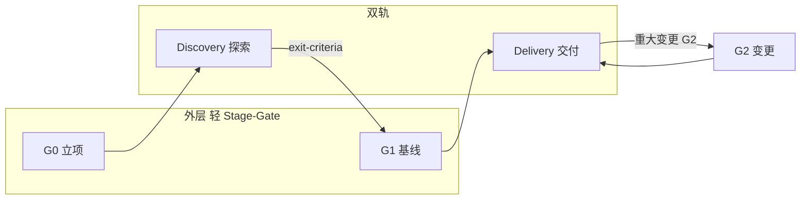

# Tenet 流程总览

Tenet 将 **大型公司里最均衡、最通用** 的协作方式压缩为 **元层规矩**（不是业务脚手架）：

**外层轻 Stage-Gate（立项与基线） + 内层 Scrum/Kanban（交付） + 双轨 Discovery（减浪费） + 能自动化就多自动化（发布与质量门禁语义）。**

用户项目里的 **目录、模块、CMake** 在 **用户 + AI** 对话中生长；Tenet 规定 **何时谈、何时落盘、AI 不能做什么**。

---

## 30 秒心智模型

| 角色 | 先打开什么 |
|------|------------|
| **AI** | [`../AGENTS.md`](../AGENTS.md) → 本文件 → 按阶段读 G0 / exit-criteria / G1 |
| **新人** | 仓库 `README.md`（顶英下中）→ 本文件 |
| **维护 Tenet** | 只改 `tenet/**`；Tenet 官方仓 **根** [`AGENTS.md`](../../AGENTS.md) 仅为路由，勿加流程正文 |

**隐喻**：Tenet = **教练 + 裁判手册**；用户的 C++ 项目 = **球员在场上怎么踢**，由引导问出来，不是 Tenet 预画战术板。

---

## 文件权威链

```text
Tenet 官方仓根 AGENTS.md          →  仅路由（「去读 tenet/AGENTS.md」）
        ↓
tenet/AGENTS.md                     →  流程与 AI 协作 SSOT（唯一权威）
        ↓
tenet/process/OVERVIEW.md           →  总图（本文件）
        ↓
tenet/process/gates/*               →  G0、G1 关口
tenet/process/discovery/*           →  Discovery 出口标准
```

**用户业务仓**（嵌入 `tenet/` 后）：

```text
<业务仓根>/AGENTS.md               →  胶水：本项目事实 + 指向 ./tenet/AGENTS.md
        ↓
<业务仓根>/tenet/AGENTS.md          →  流程权威（与 Tenet 上游同步或 vendor）
```

**不要** 在业务仓复制 Tenet 官方仓的 **根路由 AGENTS** 覆盖业务根。  
**不要** 维护两份流程正文；流程变更只改 `tenet/` 内文档。

---

## 总流程



| 层级 | 做什么 | Tenet v1 文档 |
|------|--------|----------------|
| **G0** | 值不值得做、边界、合规红线、Tenet 引用方式 | [`gates/G0-charter.md`](gates/G0-charter.md) |
| **Discovery** | 选型、ADR、spike、非功能底线 | [`discovery/exit-criteria.md`](discovery/exit-criteria.md) |
| **G1** | Discovery 出口 → 允许 **正式** 工程落盘 | [`gates/G1-baseline.md`](gates/G1-baseline.md) |
| **G1 后重大变更** | ADR + baseline 升版 | [`gates/G2-change.md`](gates/G2-change.md) |
| **Delivery** | Scrum **或** Kanban 迭代交付 | [`delivery/choose-scrum-kanban.md`](delivery/choose-scrum-kanban.md)、[`delivery/definition-of-done.md`](delivery/definition-of-done.md) |
| **发布** | 小批量、可回滚、门禁语义 | 本文件「自动化与发布」 |

**G2（重大范围/架构变更）**：[`gates/G2-change.md`](gates/G2-change.md)（G1 之后；ADR + baseline 升版）。

---

## Discovery 轨 vs Delivery 轨

| | Discovery | Delivery |
|---|-----------|----------|
| **目的** | 减少「直接开写却做错架构」的浪费 | 可预测地交付增量 |
| **典型产出** | 对比、ADR、spike 结论、依赖与风险 | 与基线一致的代码、构建、测试 |
| **Tenet 提供** | 出口标准、AI 禁止项 | G1 后落盘规则、DoD（见 [`delivery/definition-of-done.md`](delivery/definition-of-done.md)） |
| **产出放哪** | **用户项目自建**（建议 `docs/discovery/`、`docs/adr/`） | 用户 repo 内模块与构建文件 |

**硬规则**：未满足 [`discovery/exit-criteria.md`](discovery/exit-criteria.md) **且** 未过 G1 → **不** 把临时方案当作正式基线批量写入。

---

## Scrum vs Kanban（内层交付）

Tenet **不替团队选**；G1 通过时在基线记录中 **写明选用哪一种**。

| 选用 | 更适合 | v1 要点 |
|------|--------|---------|
| **Scrum** | 产品型、需固定节奏演示、2–4 周承诺 | 迭代计划 + Review 演示增量；AI 不虚构 Sprint 编号除非项目已定义 |
| **Kanban** | 运维、缺陷、持续小改、流量稳定 | 限制 WIP、可视化；AI 不强行套 Sprint 仪式 |

**v2**：[`delivery/choose-scrum-kanban.md`](delivery/choose-scrum-kanban.md)、[`delivery/definition-of-done.md`](delivery/definition-of-done.md)。

---

## 自动化与发布

Tenet **不捆绑** GitHub Actions / GitLab CI 模板作为必选项。Tenet 规定的是 **门禁语义**，便于用户自行实现自动化：

| 门禁 | 含义（语义） |
|------|----------------|
| **合并前** | 构建通过、关键测试通过、Review 完成；安全/许可证扫描按 G0 红线 |
| **发布候选** | 可部署 artifact、版本号策略、回滚路径已知 |
| **生产** | 灰度或等价策略、监控与 On-call 约定（用户项目 G0/G1 中定义） |

**原则**：能自动化就多自动化，降低 **大 bang 发布** 风险；遗留系统可先从 **合并门禁** 做起。

AI 在改代码前应提醒：**当前变更是否对应 Delivery 项、是否触及未过 ADR 的架构**。

---

## 将 `tenet/` 嵌入已有 C++ 仓

1. **引入包**：git submodule、subtree，或拷贝 `tenet/` 目录（保留 LICENSE）。
2. **业务仓根 `AGENTS.md`**（胶水模板，请按项目改写）：

```markdown
# 本项目 AGENTS

## 本地事实（示例，请改写）
- 构建：…
- 测试：…

## Tenet 流程权威
流程与 AI 协作以 [./tenet/AGENTS.md](./tenet/AGENTS.md) 为准。
本文件与 Tenet 冲突时：流程以 Tenet 为准，本地事实以本文件为准。
开始任务前 AI 必须阅读 tenet/AGENTS.md 与 tenet/process/OVERVIEW.md。
```

3. **同步**：Tenet 上游更新时只合并 `tenet/`；业务根胶水尽量保持稳定。
4. **Cursor / 其他 AI**：对话中 @ `tenet/AGENTS.md`，避免只 @ 业务根而跳过 Tenet。

---

## 单独克隆 Tenet 官方仓

用于 **阅读、贡献 Tenet 文档**，或作为 **流程模板源**。  
工具若先打开根 [`AGENTS.md`](../../AGENTS.md)，按其中指令进入 **`tenet/AGENTS.md`** 即可。

---

## v1 文档范围与 v2 路线图

**v1 已包含（或随 Delivery 迭代补齐）**

- [`../AGENTS.md`](../AGENTS.md)
- 本文件
- [`gates/G0-charter.md`](gates/G0-charter.md)
- [`gates/G1-baseline.md`](gates/G1-baseline.md)
- [`discovery/exit-criteria.md`](discovery/exit-criteria.md)
- 仓库 `README.md`

**v1.3 已包含（框架收工）**

- [`gates/G2-change.md`](gates/G2-change.md)
- [`../cpp/adr-template.md`](../cpp/adr-template.md)
- [`../adoption/for-newcomers.md`](../adoption/for-newcomers.md)（含 **拷贝 tenet + 单仓** 推荐）

**v1.1 教练层**：[`discovery/facilitation.md`](discovery/facilitation.md)、[`prompts/README.md`](prompts/README.md)、[`../collaboration/ai-collaboration.md`](../collaboration/ai-collaboration.md)

**v1.2**：[`delivery/definition-of-done.md`](delivery/definition-of-done.md)、[`delivery/choose-scrum-kanban.md`](delivery/choose-scrum-kanban.md)

**v1.4 已包含（协作与 C++ 底线）**

- [`../collaboration/roles.md`](../collaboration/roles.md)、[`code-review.md`](../collaboration/code-review.md)
- [`../cpp/engineering-standards.md`](../cpp/engineering-standards.md)
- [`../adoption/for-leads.md`](../adoption/for-leads.md)

**路线图**：v1.4 文档集齐；**Git 提交**（Tenet 官方仓）见仓库根 [`CONTRIBUTING.md`](../../CONTRIBUTING.md)。新主题 **Issue 驱动**。

---

## 语言

Tenet v1 **流程正文全中文**。仓库 `README.md` 采用 **顶英下中**（英文块仅在定位变更时更新）。  
专有名词首次出现可用 **中文（English）**；完整对照见 [`../AGENTS.md`](../AGENTS.md) 附录。

---

**文档版本**：v1.4 · 完整元层文档集（流程 + 教练 + G2 + 协作 + C++ 底线 + adoption）
